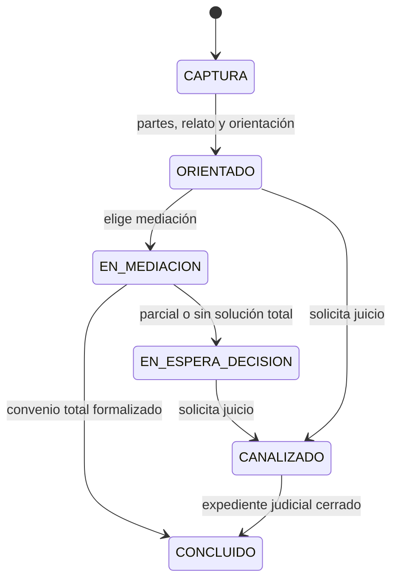
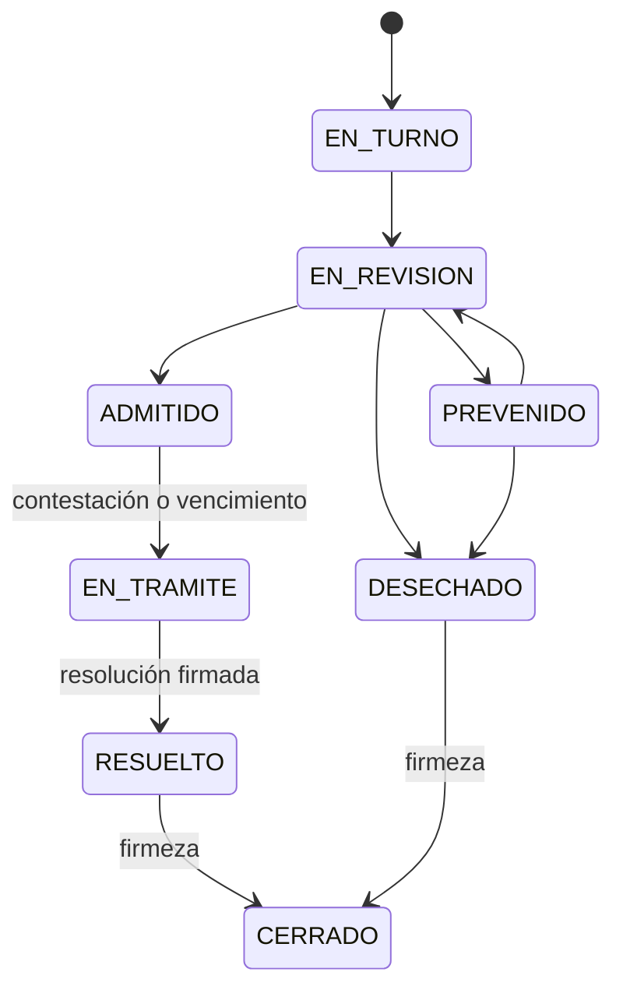

# Decisión 001: estados y contratos del caso para el MVP

**Estado:** adoptada para la demostración local de ESCOM.

## Identificadores y reglas comunes

- `conflicto_id` identifica el asunto desde la captura. `mediacion_id`, `demanda_id` y `expediente_id` se crean solo al entrar en sus respectivas rutas.
- Cada comando de cambio de estado registra actor, fecha y hora, estado previo, estado nuevo, motivo e identificador de operación en una bitácora de solo adición.
- Las operaciones que crean una demanda, firman un convenio, registran contestación o cierran un expediente usan una clave de idempotencia para evitar duplicados por reintentos.
- Los estados expresan avance del trámite. El resultado de la mediación y el sentido de la resolución son campos separados; nunca se deducen solo del nombre de un estado.

## Estados del conflicto

| Estado | Entrada | Salidas permitidas |
| --- | --- | --- |
| `CAPTURA` | Se crea el conflicto. | `ORIENTADO` cuando existen datos de demandante, demandado y narrativa inicial, y se registra la orientación. |
| `ORIENTADO` | Se completó el análisis de materia y mediabilidad. | `EN_MEDIACION` si el ciudadano elige esa vía y procede; `CANALIZADO` si solicita la vía judicial y se ejecuta el contrato ordinario. |
| `EN_MEDIACION` | Se emite la invitación. | `CONCLUIDO` solo con convenio total formalizado; `EN_ESPERA_DECISION` ante convenio parcial formalizado, sin acuerdo, invitación no aceptada o desistimiento. |
| `EN_ESPERA_DECISION` | La mediación terminó sin resolver todo el conflicto. | `CANALIZADO` si el solicitante pide continuar judicialmente, incluso después de desistir solo de la mediación. Permanecer aquí no equivale a cierre. |
| `CANALIZADO` | El puente creó un borrador de demanda. | `CONCLUIDO` únicamente cuando el expediente judicial asociado queda `CERRADO`. |
| `CONCLUIDO` | Existe solución documentada válida para la ruta. | Sin transición ordinaria; actuaciones posteriores son registros vinculados. |

El sistema no canaliza automáticamente al clasificar un caso como no mediable: muestra la orientación y espera la decisión del solicitante. Una captura incompleta no invoca PLN.

## Estados de mediación e invitación

| Objeto | Estados y transición | Condición |
| --- | --- | --- |
| Invitación | `ENVIADA → ACEPTADA` | La contraparte acepta. |
| Invitación | `ENVIADA → RECHAZADA` o `ENVIADA → VENCIDA` | Rechazo expreso o tarea de vencimiento. |
| Mediación | `INVITACION_ENVIADA → EN_NEGOCIACION` | Invitación aceptada. Puede registrarse un mediador sin alterar la ruta. |
| Mediación | `EN_NEGOCIACION → PENDIENTE_FORMALIZACION` | Se redacta un convenio total o parcial. |
| Mediación | `PENDIENTE_FORMALIZACION → CONCLUIDA` | Se completa la formalización y se registra resultado `ACUERDO_TOTAL` o `ACUERDO_PARCIAL`. |
| Mediación | `INVITACION_ENVIADA` o `EN_NEGOCIACION → CONCLUIDA` | Resultado `NO_ACEPTADA`, `SIN_ACUERDO` o `DESISTIMIENTO`, según el evento. |

Un acuerdo sin las firmas y constancias exigidas permanece `PENDIENTE_FORMALIZACION`; sus puntos pendientes no se canalizan todavía. Un convenio parcial formalizado resuelve solo los puntos acordados y mantiene abierto el conflicto.

## Estados de demanda y expediente

La demanda pasa de `BORRADOR` a `CONFIRMADA` por acción expresa del demandante. Solo entonces se crea el expediente.

| Estado del expediente | Siguiente estado | Guarda de transición |
| --- | --- | --- |
| `EN_TURNO` | `EN_REVISION` | Turno confirmado por operador autorizado. |
| `EN_REVISION` | `PREVENIDO` | Requerimiento de corrección registrado. |
| `PREVENIDO` | `EN_REVISION` | Corrección presentada; no existe cierre automático por falta de corrección. |
| `EN_REVISION` | `ADMITIDO` | Admisión registrada por juez autorizado. |
| `EN_REVISION` o `PREVENIDO` | `DESECHADO` | Resolución de desechamiento firmada, con resultado y sello de tiempo. |
| `ADMITIDO` | `EN_TRAMITE` | Se registra contestación o vence el plazo tras emplazamiento válido. La ausencia de contestación no equivale a solución. |
| `EN_TRAMITE` | `RESUELTO` | Resolución firmada, con resultado explícito y sello de tiempo. |
| `RESUELTO` o `DESECHADO` | `CERRADO` | Consta la firmeza y existe una resolución documentada asociada. |

El plazo fijo del prototipo es de **15 días naturales desde el emplazamiento validado**. Se almacenan `fecha_emplazamiento_validado`, `fecha_limite_contestacion`, `fecha_presentacion_contestacion` y `contestacion_en_plazo`. El vencimiento sin escrito se registra como evento; no crea una contestación ficticia. Una presentación tardía se registra como tardía y su tratamiento queda sujeto a decisión del operador jurídico, no a un rechazo automático.

## Contratos y operaciones

| Operación | Precondición | Resultado o evento |
| --- | --- | --- |
| Capturar partes | Conflicto `CAPTURA` | Demandante y demandado registrados antes del relato. |
| Registrar relato y orientar | Ambas partes completas y narrativa inicial | Clasificación sugerida; materia y mediabilidad confirmadas por persona autorizada; conflicto `ORIENTADO`. |
| Elegir vía | Conflicto `ORIENTADO` | Inicia invitación ODR o solicita canalización ordinaria. |
| Concluir mediación | Invitación o negociación en estado compatible | Resultado explícito; si hay convenio, espera formalización. |
| Formalizar convenio | Firmas y documento con huella y sello de tiempo | `ACUERDO_TOTAL` concluye; `ACUERDO_PARCIAL` habilita solo puntos pendientes. |
| Canalizar | Solicitud autenticada y resultado elegible | Crea una sola demanda `BORRADOR`; cambia conflicto a `CANALIZADO`; emite `DemandaBorradorCreada`. |
| Confirmar demanda | Borrador revisado por demandante | Demanda `CONFIRMADA` y expediente `EN_TURNO`. |
| Registrar emplazamiento | Expediente `ADMITIDO` y constancia de validez | Calcula la fecha límite de contestación. |
| Registrar contestación | Emplazamiento válido | Guarda fecha y condición de plazo; expediente `EN_TRAMITE`. |
| Registrar resolución y firmeza | Expediente judicial elegible | `RESUELTO` o `DESECHADO`; luego `CERRADO` solo al acreditarse firmeza. |

Los [dos esquemas de canalización](../../contracts/canalizacion/README.md) versionan el único intercambio de ODR a judicial. El intercambio de [turno con IA](../../contracts/api_interna/README.md) también tiene límites explícitos.

## Regla de cierre comprobable

`conflicto.CONCLUIDO` exige **exactamente una vía de solución principal**: convenio total formalizado o expediente judicial cerrado con resolución firmada, resultado, sello de tiempo y firmeza. `expediente.CERRADO` exige la segunda. Convenio parcial, desistimiento, demanda desechada aún no firme, prevención, vencimiento de invitación y falta de contestación nunca cierran por sí solos.

Esta definición fija el comportamiento del prototipo. La validez procesal de plazos y actuaciones requiere revisión institucional antes de usar casos reales.
